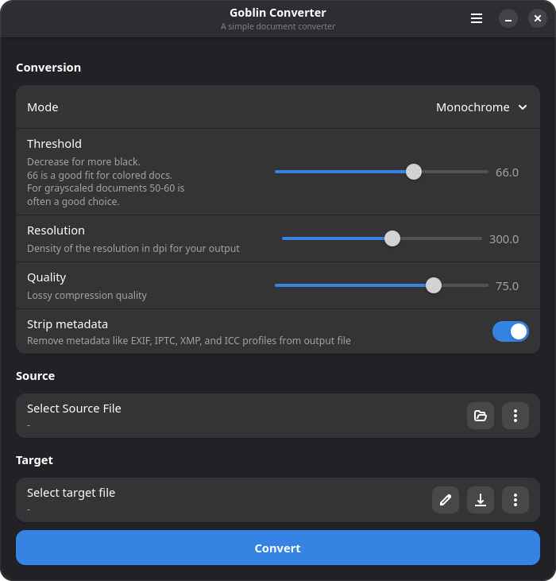

<div align="center">
  
</div>

# Goblin Converter

[](https://github.com/magynhard/goblin-converter/actions/workflows/linux-packages.yml)
[](#)
[](#)
[](LICENSE)

>
> A simple document converter GUI for GTK using magick

Initial use case was to convert 300ppi (PDF) documents (grayscale or colored) to monochrome (PDF) documents to reduce the size significantly for digital document storage.

E.g. a PDF document with 300ppi and about 3-4MB in grayscale can be reduced to about 40-75KB(!) in monochrome.



# Setup
Download the Windows setup, build AppImage or local Flatpak bundles, or install from source. The GitHub
Actions workflow attaches packages to newly published [GitHub Releases](https://github.com/magynhard/goblin-converter/releases).

## Windows

Download `Goblin_Converter-<version>-windows-x86_64-setup.exe` from
[GitHub Releases](https://github.com/magynhard/goblin-converter/releases) and run it.
The setup installs for the current user without administrator privileges and adds
a Start menu shortcut. A desktop shortcut is optional. GTK, ImageMagick and
Ghostscript are included; no development tools or separate runtime installations
are needed. Remove it through Windows **Installed apps**.

See [Windows packaging](doc/windows-packaging.md) for local builds, CI smoke tests
and release details. Windows packages target x64 Windows 10/11.

## Flatpak
```bash
flatpak install --user ./Goblin_Converter-0.1.1-x86_64.flatpak
flatpak run de.magynhard.GoblinConverter
```

## AppImage

```sh
chmod +x Goblin_Converter-0.1.1-x86_64.AppImage
./Goblin_Converter-0.1.1-x86_64.AppImage
```

Replace `0.1.1` with the downloaded version. Both formats include ImageMagick and
Ghostscript. AppImage requires Ubuntu 26.04/glibc 2.43 or newer; use Flatpak on
older distributions. The Flatpak is a downloadable local bundle.

## Build Linux packages

```sh
make appimage   # Docker-based x86_64 build
make flatpak   # GNOME SDK 51 build
```

Packages and SHA-256 files are written to `dist/`. See [Linux packaging](doc/packaging.md)
for prerequisites, verification and the GitHub Actions release workflow.
See the [changelog](CHANGELOG.md) for release history.

## Local
Ensure, Crystal is installed.

Beside, you need to have build tools and other dependencies to be installed.
### Ubuntu
```
sudo apt install build-essential libcairo2-dev libgirepository1.0-dev libgdk-pixbuf2.0-dev libgtk-4-common libgtk-4-dev libadwaita-1-0 libadwaita-1-dev imagemagick crystal
```
### Manjaro/Arch
```
sudo pacman -S base-devel crystal gtk4 libadwaita imagemagick
```

#### Install
```
git clone https://github.com/magynhard/goblin-converter.git
cd goblin-converter
shards install
make install
```
### Uninstall
```
cd goblin-converter
make uninstall
```

# Development
## Conversion modes

Selecting a mode applies its defaults. Sliders remain adjustable afterward.

| Mode | Resolution | Quality | Threshold |
| --- | --- | --- | --- |
| Monochrome | 300 dpi | 75 (not used by Fax compression) | 66 |
| Grayscale | 170 dpi | 40 | 66 |
| Color | 140 dpi | 50 | 66 |

Grayscale and color use JPEG compression. The threshold is only applied in
monochrome mode. Changing modes preserves the strip-metadata setting.
Run `make test-conversion-modes` to check mode switching and slider synchronization
under Xvfb.

## Opening files

Pass local file paths or `file://` URIs to prefill the source and suggested target:

```sh
goblin-converter "/path/to/my document.pdf"
goblin-converter first.pdf second.pdf
```

Each file opens in its own window, including when the application is already
running. The desktop entry supports the file manager's **Open With** action.
Run `make test-file-opening` to check startup and running-instance file delivery
with a private session bus and Xvfb (requires Python 3, `gdbus`, `dbus-run-session`,
`xvfb-run` and `xauth`).

Target platforms are Linux (primary) and Windows. macOS is not planned.

## Requirements (development)
* Crystal 1.21+
* GTK4
* ImageMagick 7
* Ghostscript 10

### Windows (verified 2026-10-02, MSVC route)
Release binaries are built and tested on Windows. Crystal can emit Windows object
code on Linux, but this does not perform the MSVC/Windows SDK/GTK linking step.

1. Install: Crystal for Windows (MSVC, portable zip) + VS2022 Build Tools
   ("Desktop development with C++", MSVC v143 x64) + Windows 10 SDK.
   Enable Developer Mode in Windows Settings.
2. Unzip a wingtk/gvsbuild `GTK4_Gvsbuild_<ver>_x64.zip` to `C:\gtk`
   (provides GTK4/Adwaita, GObject-Introspection, pkg-config, msgfmt).
3. Per PowerShell session, load the env (adjust paths if needed):
   ```
   . .\scripts\goblin-env.ps1 [-GtkDir C:\gtk] [-CrystalDir ...] [-ImageMagickDir ...] [-GhostscriptDir ...]
   ```
4. Then as usual (no `make` needed):
   ```
   shards install
   .\bin\gi-crystal.exe
   crystal build src/goblin-converter.cr -o bin/goblin-converter.exe
   crystal spec
   ```
   `make install` is Unix-only. Runtime needs ImageMagick 7 (`magick.exe`,
   portable zip works) and Ghostscript 10 (`gs` installer, run elevated —
   there is no portable zip) plus `C:\gtk\bin` on `PATH` (for the GTK DLLs).
   Tip: if monochrome Fax/PDF output looks broken and your user name contains
   non-ASCII chars, set `MAGICK_TEMPORARY_PATH` to an ASCII-only directory.

## Install local for development
```
make install
```

## Build
```
make build
```

## Run
```
make run
```

## Create locales
```
make locales
```

## Clean
```
make clean
```

## Create new version
### Update version in shard.yml and the first AppStream release entry
```yaml
version: 0.X.X
```

### Create tag
```
git tag 0.X.X
git push origin 0.X.X
```

Publish the GitHub release for that tag to build and attach Windows setup,
AppImage and Flatpak packages automatically. See
[Linux packaging](doc/packaging.md#verification-and-releases) and
[Windows packaging](doc/windows-packaging.md).
